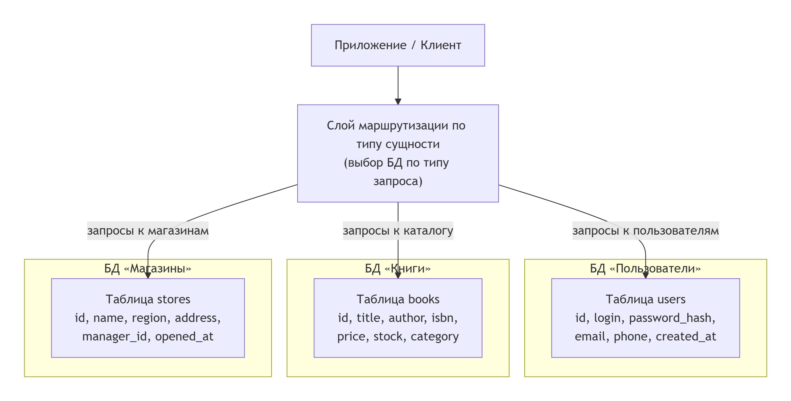
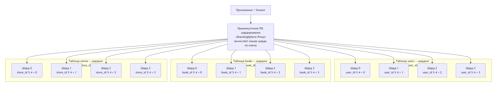

# Задание по занятию "Репликация и масштабирование. Часть 2" Шаталов Л.Ю.

## Задание 1

Опишите основные преимущества использования масштабирования методами:

активный master-сервер и пассивный репликационный slave-сервер;
master-сервер и несколько slave-серверов;
Дайте ответ в свободной форме.

### Активный master-сервер и пассивный репликационный slave-сервер. 

Такая схема применяется прежде всего для обеспечения высокой доступности и отказоустойчивости: пассивный slave постоянно реплицирует данные с master и находится в «горячем резерве», поэтому при отказе основного сервера его можно быстро повысить до активного, сократив время простоя (RTO) и минимизировав потерю данных (RPO) — особенно при синхронной репликации, когда master подтверждает транзакцию только после записи на slave. Дополнительное преимущество — простота и предсказуемость: запись в любой момент времени принимает только один узел, поэтому отсутствуют конфликты записи, характерные для актив-активных схем, а технологии отказоустойчивости хорошо отлажены и проверены в production-средах.

### Master-сервер и несколько slave-серверов. 

Главное преимущество этой схемы горизонтальное масштабирование чтения. Несколько slave-серверов одновременно обслуживают запросы на чтение, что позволяет выйти за пределы возможностей одного сервера без дорогостоящего вертикального масштабирования и характерно для систем с преобладанием чтения (каталоги, дашборды и т.п.). Перенос ресурсоёмких операций чтения на slave освобождает ресурсы master для транзакций записи и снижает общую задержку системы.

## Задание 2

Разработайте план для выполнения горизонтального и вертикального шаринга базы данных. База данных состоит из трёх таблиц:

пользователи,

книги,

магазины (столбцы произвольно).

Опишите принципы построения системы и их разграничение или разбивку между базами данных.

Пришлите блоксхему, где и что будет располагаться. Опишите, в каких режимах будут работать сервера.

### Вертикальный шардинг

Три таблицы разносятся по трём независимым кластерам БД по функциональному признаку. БД «Пользователи» хранит таблицу users (id, login, password_hash, email, phone, created_at) — это конфиденциальный контур аутентификации и профилей. БД «Книги» хранит таблицу books (id, title, author, isbn, price, stock, category) — каталог с преобладанием чтения. БД «Магазины» хранит таблицу stores (id, name, region, address, manager_id, opened_at) — торговый контур, связанный с заказами и остатками. Кластеры не реплицируются между собой: каждая БД отвечает только за свою предметную область.

Доступ к каждой БД идёт через отдельный пул соединений; слой маршрутизации по типу сущности (или ORM с несколькими источниками данных) направляет запрос в нужную базу. Внутри каждого кластера развёрнута пара Master–Slave: Master в активном режиме принимает записи, Slave в режиме репликации обслуживает чтение.

Каждая из трёх БД — самостоятельный кластер по схеме Master–Slave: Master работает в режиме активной обработки транзакций (запись), Slave — в режиме репликации и обслуживания чтения. Между кластерами репликации нет.

### Горизонтальный шардинг

Внутри каждого вертикального кластера таблица делится по ключу шардирования методом хеш-модуля: users — по user_id % 4, books — по book_id % 4, stores — по store_id % 4. Каждый шард содержит непересекающееся подмножество строк: шард 0 — строки с остатком 0, шард 1 — с остатком 1 и т. д. Промежуточное ПО шардирования вычисляет номер шарда по значению ключа и направляет запрос в нужный шард; запросы без ключа шардирования обходятся по всем шардам с агрегацией результата на стороне прокси.

Каждый шард развёрнут по схеме Master–Slave с разделением чтения и записи: Master шарда в активном режиме принимает записи и пишет Binlog, Slave-серверы в режиме репликации воспроизводят Binlog и обслуживают чтение. Прокси направляет запись на Master нужного шарда, чтение распределяет между Slave этого шарда; при отказе Master один из Slave повышается до активного.

Master каждого шарда назодится в режиме активной обработки транзакций. Slave каждого шарда в режиме репликации Binlog и обслуживания чтения. Прокси маршрутизирует запись на Master, чтение — на Slave соответствующего шарда.

